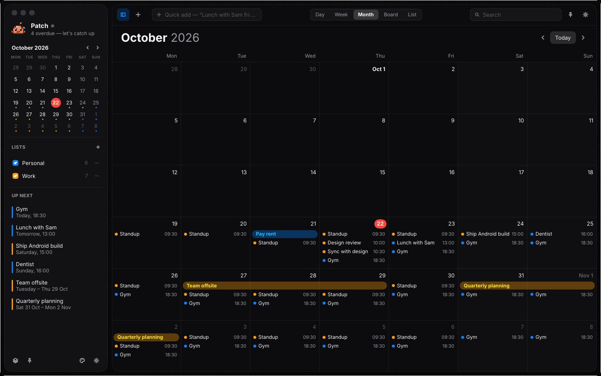
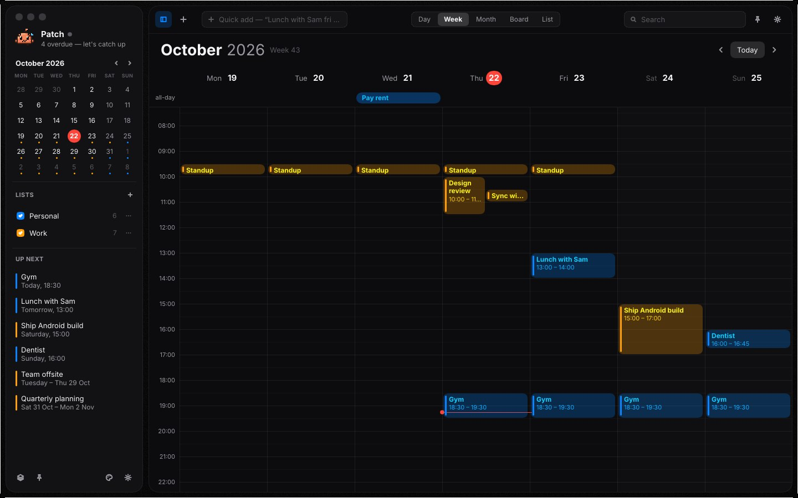
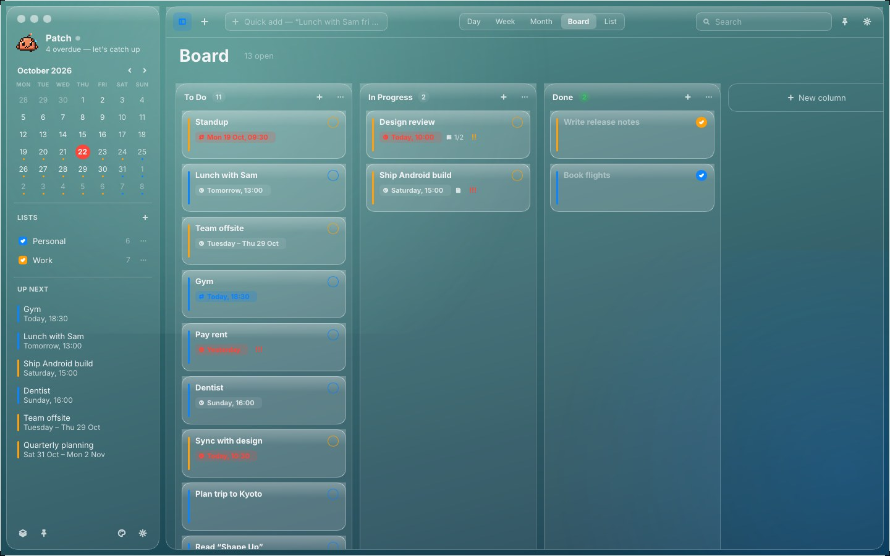
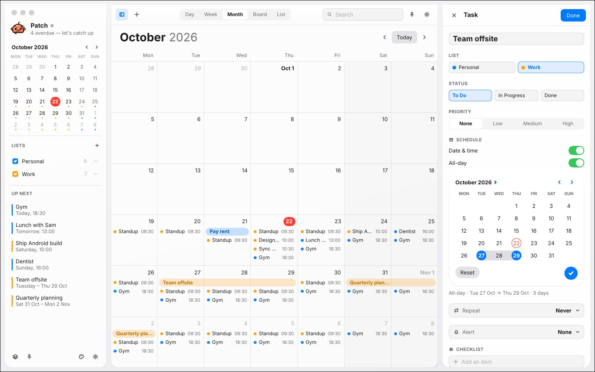
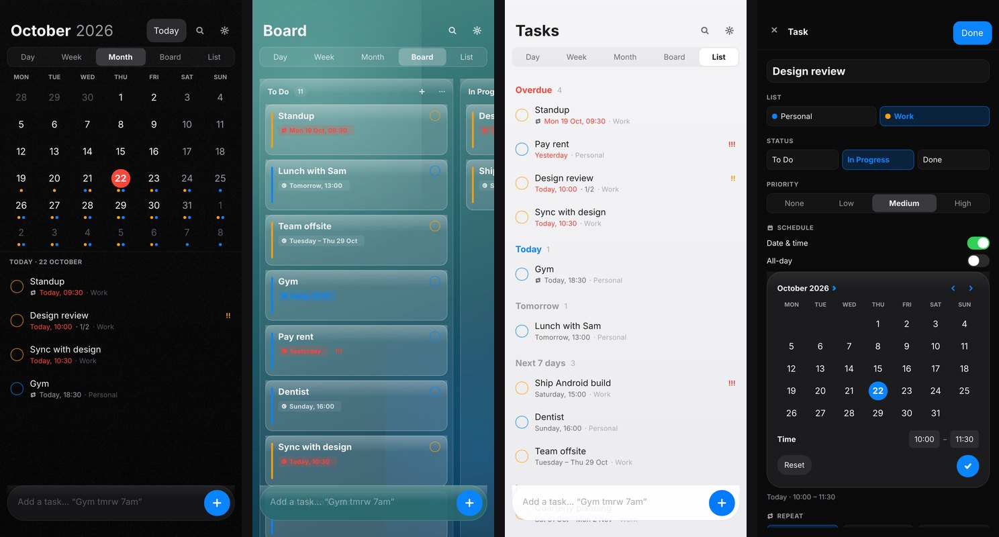
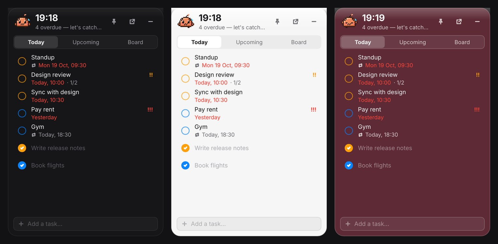
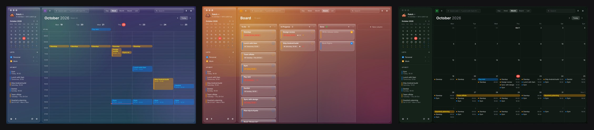

# Patch

An always-on todo list, kanban board and calendar — native Rust on **Linux** and
**Android**, matte black and glassy, laid out like the macOS Calendar, and synced
between your devices **over Tailscale** only.



| Week | Board (Liquid Glass) | Editor with range picker (Light) |
|---|---|---|
|  |  |  |

**Android**: the phone layout, a home-screen widget, and Patch the pet, which
floats *over other apps* when you want it to.




**Ten themes**: Matte Black, Liquid Glass, Light, Midnight, Aurora, Sunset, Forest, Graphite, Paper and Rose.



[](https://slint.dev)

## Features

- **Calendar like macOS**: Day, Week and Month views. Multi-day items are bars that keep their lane across a week. The week grid lays overlapping items side by side and shows a red "now" line. You can drag to move and drag the bottom edge to resize, snapping to 15 minutes.
- **Kanban board**: drag cards between columns and reorder them; on phones, long-press to drag. You can add, rename and delete columns. Dropping a card in **Done** completes it.
- **Todo list**: grouped into Overdue, Today, Tomorrow, Next 7 days, Later, Someday and Completed.
- **Task inspector**:
  - list, status, priority, checklist and notes
  - repeats (daily, weekdays, weekly, monthly, yearly) and reminders, picked from tidy drop-downs
  - your own repeat intervals ("every 2 weeks") and alert timings ("3 hours before"), added once in Settings → *Repeat & alerts*
  - the date-range picker from the design reference: tap a start, tap an end, set times, then Reset or ✓
- **Natural-language quick add**: `Dentist tomorrow 3pm #work !!!`, `Conference 13-15 nov`, `Standup every weekday 9:30`, `Gym tmrw 7am for 1h30m`, `Call back in 2 hours`.
- **Ten themes**, each with a live preview in Settings.
- **Lists with your colours**: open a list's ⋯ menu to recolour, rename or delete it.
- **Patch the pet**: a pixel-art buddy that bobs, blinks and reacts to your day. It is happy when you're clear, busy when you have work, worried about overdue tasks, and asleep at night.
- **Always on**:
  - **Linux**: a frameless window with rounded corners and its own controls. The widget (Today / Upcoming / Board with quick add) sits on the desktop like a home-screen widget; pin it to float above your apps, and it stays on top even when you click elsewhere. Also a tray icon, start at login, and desktop notifications.
  - **Android**: a **home-screen widget** with today's and upcoming tasks and the pet. Turn on *Display over other apps* when you want the pet to hover above other apps; tap it to open the same panel. Reminders arrive as system notifications.
- **Offline first**: every device keeps a full copy and edits merge field by field, so nothing is lost when two devices change the same task.

## Sync over Tailscale

One machine runs the **hub**: the Linux app (Settings → *Host the sync hub on this
computer*) or the headless `patch-hub` on any always-on box such as a home server
or Raspberry Pi. Every other device connects to it.

1. Install [Tailscale](https://tailscale.com) on each device and sign in to the same tailnet.
2. On the hub machine, turn on hosting. Settings shows the addresses (e.g. `http://my-laptop:4747`) and a pairing token like `K7QF-2MZD-9XPA-T4RH`.
3. On the phone (or another computer): Settings → *Sync over Tailscale* → enter the address and the token → **Connect**.

Edits show up on the other devices within about a second (long-polling), and a
device that was offline catches up when it reconnects.

Security model:

- The hub only answers loopback and Tailscale peers (`100.64.0.0/10`, `fd7a:115c:a1e0::/48`). Add `--allow-lan` to also accept your LAN.
- Every request needs the pairing token.
- Traffic is plain HTTP *inside* the WireGuard tunnel Tailscale provides, so it is encrypted end to end without a TLS stack on the phone.

How it merges: every field of every task carries a hybrid-logical-clock stamp.
Merging keeps the newest write per field, which is commutative and idempotent,
so devices converge regardless of the order they sync in
([`crates/core`](crates/core/src)).

## Install

### Linux

```sh
scripts/install-linux.sh            # builds `patch` + `patch-hub`, installs to ~/.local
patch                               # or launch "Patch" from your app menu
```

The headless hub as a systemd user service:

```sh
cargo build --release -p patch-sync --bin patch-hub
install -Dm755 target/release/patch-hub ~/.local/bin/patch-hub
install -Dm644 packaging/linux/patch-hub.service ~/.config/systemd/user/patch-hub.service
systemctl --user enable --now patch-hub
journalctl --user -u patch-hub      # shows the pairing token and URLs
```

Build dependencies (Debian/Ubuntu): `build-essential pkg-config libfontconfig1-dev libxkbcommon-dev libwayland-dev libdbus-1-dev`.

### Android

**[Download the latest APK](https://github.com/MDHaarith/Patch/releases/latest)** from the
Releases page. Numbered versions are published from `v*` tags, and the
**[nightly](https://github.com/MDHaarith/Patch/releases/tag/nightly)** pre-release is refreshed on every push to `main`.
Open the `.apk` on your phone to install it, then long-press the home screen →
*Widgets* → **Patch** to add the widget.

<details>
<summary>Maintainers: set up the release signing key (once)</summary>

Android only installs an update when it is signed with the same key as the
installed app, so releases use one permanent key stored as repository secrets:

```sh
keytool -genkeypair -v -keystore patch-release.jks -alias patch \
  -keyalg RSA -keysize 4096 -validity 36500
base64 -w0 patch-release.jks    # → ANDROID_KEYSTORE_BASE64
```

Add `ANDROID_KEYSTORE_BASE64`, `ANDROID_KEYSTORE_PASSWORD`, `ANDROID_KEY_ALIAS` (`patch`)
and `ANDROID_KEY_PASSWORD` under *Settings → Secrets and variables → Actions*. Keep the
`.jks` file backed up. Then publish a version:

```sh
git tag v0.2.0 && git push origin v0.2.0
```
</details>

Or build it yourself:

```sh
rustup target add aarch64-linux-android x86_64-linux-android
cargo install cargo-ndk
cd android && ./gradlew assembleRelease    # needs ANDROID_HOME and NDK 28
```

To let the pet hover above other apps, open Settings → *Display over other apps*;
Android will ask you to grant that permission.

## Using it

| Quick add | Result |
|---|---|
| `Pay rent 1st #personal !!!` | all-day on the 1st, Personal list, high priority |
| `Team sync fri 10-11am` | Friday 10:00–11:00 |
| `Conference 13-15 nov` | all-day range |
| `Water plants every sunday` | weekly repeat |
| `Check oven in 20 min` | 20 minutes from now |

Desktop shortcuts: `N` new task · `T` today · `D/W/M/B/L` or `1–5` views ·
`←/→` previous/next · `/` or `Ctrl+F` search · `Ctrl+,` settings · `Esc` close.

## Project layout

```
crates/core      data model, hybrid logical clock, CRDT merge, recurrence, quick-add parser
crates/sync      Tailscale-only hub (tiny HTTP + long-poll), sync client, `patch-hub` binary
crates/ui        the shared Slint UI (ui/*.slint) and the App controller
apps/linux       native Linux shell: winit window, tray, always-on-top widget, hub hosting
crates/android   Rust cdylib: custom Slint platform rendering into Android Surfaces
android/         Gradle project: Activity, overlay service, IME bridge (thin Java glue)
packaging/linux  .desktop entry, icons, AppStream metadata, systemd unit
```

On Android one Rust process renders every surface — the full-screen app and the
floating overlay — through a custom Slint platform (software renderer → `ANativeWindow`).
Java only hosts the Activity, the overlay window and the keyboard bridge.

## Development

```sh
cargo test                                   # core, sync, ui (incl. a UI interaction test)
cargo clippy --all-targets
cargo run -p patch-ui --example shots -- screenshots/   # render every screen in every theme
cargo run -p patch-ui --example pet_sheet -- pet.png    # the pet's frames; --android <res> regenerates the widget's
cargo run -p patch-ui --example icons                 # all desktop and Android app icons
```

## License

MIT for Patch itself (see [LICENSE](LICENSE)). The UI is built with
[Slint](https://slint.dev) under its royalty-free license (attribution in
Settings → About and the badge above). Inter font under the SIL OFL 1.1.
